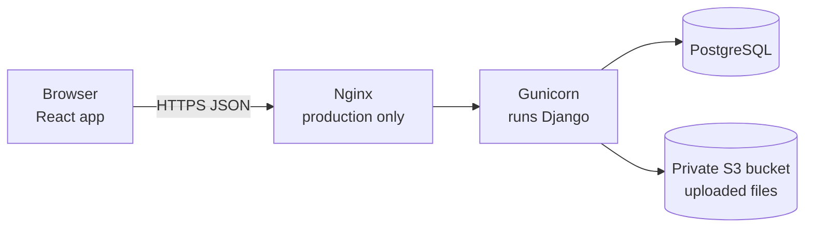
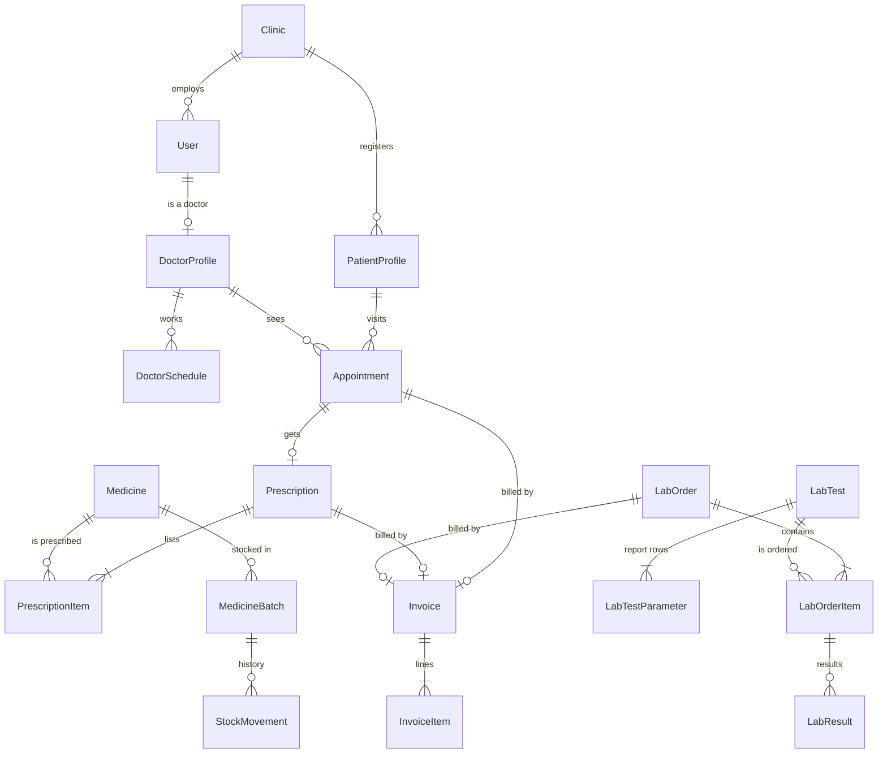

# CliniSar back end: how it works

This document explains how the Django back end is built, how data moves through it,
which code does what, and why it was built that way. Read it next to the code: every
section names the files to open.

## 1. The big picture



- The **browser** only ever talks JSON to `/api/v1/...`.
- **Nginx** (production) terminates HTTPS and forwards requests to **Gunicorn**, which
  runs several Django worker processes.
- **PostgreSQL** holds all data. Many business rules are also enforced here, as
  constraints, so even a bug in Python cannot break them.
- **S3** holds uploaded files in production; the API hands out links valid for 5 minutes.

## 2. The life of one request

Example: a receptionist books a slot, `POST /api/v1/appointments/`.

```mermaid
sequenceDiagram
    participant C as Browser
    participant M as Middleware
    participant V as AppointmentViewSet
    participant P as Permissions
    participant S as Serializer
    participant SV as scheduling/services.py
    participant DB as PostgreSQL

    C->>M: POST /api/v1/appointments/ + Bearer token
    M->>V: RequestLogMiddleware adds an id, starts a timer
    V->>V: JWTAuthentication: token -> request.user
    V->>P: IsAdminOrStaff? (role check)
    V->>S: AppointmentCreateSerializer: types, required fields,<br/>patient and doctor must be in the user's clinic
    V->>SV: book_appointment(...)
    SV->>DB: BEGIN; is it a real, free, future slot?
    SV->>DB: INSERT appointment (unique constraint guards the slot)
    SV->>DB: lock clinic row, next invoice number, INSERT invoice + line
    SV->>DB: COMMIT
    V->>DB: INSERT audit log row
    V-->>C: 201 + appointment JSON
    M-->>C: X-Request-ID header, one log line
```

Every endpoint follows the same layers:

| Layer | Job | Where |
| ----- | --- | ----- |
| Middleware | request id + log line (method, path, status, duration) | `apps/common/middleware.py` |
| Authentication | read the JWT, find the user | `rest_framework_simplejwt`, set in `config/settings/base.py` |
| Permission classes | "may this ROLE use this endpoint at all?" | `apps/common/permissions.py`, `get_permissions()` in views |
| `get_queryset()` | "which ROWS may this user see?": own clinic, then narrowed by role | `apps/common/views.py` (`TenantViewSet`) and each viewset |
| Serializer | shape and validity of the JSON; related ids must be in the same clinic | `*/serializers.py`, `apps/common/serializers.py` |
| Service | the business rule, inside a database transaction | `*/services.py` |
| Model + database | tables, and constraints as the last line of defence | `*/models.py`, `*/migrations/` |

**Why views are thin.** A view only reads the request, calls one service function and
returns the result. The rules (slot booking, dispensing, invoice maths) live in
`services.py`, where they are plain functions that tests can call directly and where
one rule is written exactly once.

## 3. Multi-tenancy: one deployment, many clinics

This is the most important property of the system: a clinic never sees another
clinic's data.

1. Every clinic-owned table inherits `TenantModel` (`apps/common/models.py`), which adds
   an indexed `clinic` column.
2. Every clinic-owned endpoint inherits `TenantViewSet` (`apps/common/views.py`):
   - `get_queryset()` filters by `request.user.clinic`;
   - `perform_create()` saves `clinic = request.user.clinic`.
3. The clinic comes from the logged-in user (from the verified JWT). No serializer has a
   `clinic` field, so a clinic id sent by the client is ignored.
4. Links to other objects use `TenantPrimaryKeyRelatedField`, which only accepts objects
   of the same clinic.
5. Another clinic's object is simply not in the queryset, so asking for it gives **404**
   (not 403, which would reveal that the id exists).
6. `apps/common/tests/test_tenant_isolation.py` checks every tenant endpoint: clinic B's
   objects are missing from clinic A's lists and every detail/action URL returns 404.

Why not middleware? DRF authenticates the JWT inside the view, after middleware has run,
so middleware does not yet know the user.

## 4. Roles and row-level rules

- **Endpoint level**: permission classes (`IsClinicAdmin`, `IsStaff`, `IsDoctor`,
  `IsPharmacist`, `IsLabTechnician`, `IsAdminOrStaff`, `ReadOnly`) combined with `|` and
  `&`, e.g. `IsClinicAdmin | ReadOnly`.
- **Row level**: `get_queryset()` narrows further, e.g. a doctor sees only their own
  appointments and their own patients' prescriptions, lab orders and documents; a
  pharmacist sees only PHARMACY invoices. The front desk (STAFF) may also run the
  pharmacy and dispense, because in a small clinic one person does both.
- The front end hides menus a role cannot use, but **the API is the real guard**: every
  request is checked again here.

## 5. Sessions and security

| Topic | How | Why |
| ----- | --- | --- |
| Login | `POST auth/login/` checks the password, returns a 15-minute access token in JSON | short life limits the damage of a leaked token |
| Refresh token | 7 days, in an `httpOnly; Secure; SameSite=Strict` cookie on `/api/v1/auth/` | JavaScript cannot read it; other sites cannot make the browser send it |
| Rotation | each refresh returns a new refresh token and blacklists the old one | a stolen refresh token works at most once |
| Logout | blacklists the refresh token and clears the cookie | a copied cookie stops working |
| Passwords | Django validators, minimum 8 characters, stored hashed | never stored readable |
| Rate limits | every endpoint: 300/min per user, 120/min per IP when not logged in, login 5/min per IP; nginx adds 20/s per IP and 5/min on the admin login | slows password guessing and stops one client from flooding the API |
| Uploads | PDF/JPG/PNG only, max 10 MB, first bytes checked (`apps/common/validators.py`) | a renamed program is refused |
| Settings | secrets from environment variables; `prod.py` refuses to start without a secret key | no secret in Git |
| Audit | who created/changed/deleted appointments, prescriptions, lab orders, invoices, documents | accountability |

Files: `apps/accounts/services.py`, `apps/accounts/views.py`, `apps/accounts/cookies.py`.

## 6. Data model



Design rules used everywhere:

- **UUID primary keys**: ids in URLs cannot be guessed or counted.
- **`Decimal` for money** (`money_field()`), never float.
- **`PROTECT`** on medical and money links: a patient with history cannot be deleted
  by accident (the API answers 409).
- **Computed, not stored**: free slots (from schedules) and available stock (sum of
  unexpired batches) are calculated, so they can never drift out of sync.
- **Copies for history**: invoice lines copy description and price; invoices copy the
  VAT rate and issuer name/PAN; lab results copy name, unit and range. Later edits never
  change old bills or reports.

## 7. The main flows, and the code for each

| Flow | Entry point | Rules | Safety |
| ---- | ----------- | ----- | ------ |
| Free slots | `GET doctors/<id>/slots/` | `scheduling/services.py: free_slots` | Nepal time for "now" |
| Booking | `POST appointments/` | `book_appointment` | transaction + unique constraint -> 409 on a double booking |
| Walk-in | `POST appointments/` with `WALK_IN` | `add_walk_in` | doctor row locked while picking the queue number |
| Invoice | created by booking, dispensing, lab ordering | `billing/services.py: create_invoice` | clinic row locked for the number; one maths function |
| Pay / cancel bill | `POST invoices/<id>/pay/`, `cancel/` | `pay_invoice`, `cancel_invoice` | invoice row locked; PAID is final |
| Stock change | purchase, adjust, dispense | `pharmacy/services.py: change_stock` | the only code that changes a batch; row lock; never below 0 |
| Dispensing | `POST prescriptions/<id>/dispense/` | `dispense_prescription` | earliest expiry first, spill to next batch, expired never used, 409 changes nothing |
| Lab order | `POST lab-orders/` and its steps | `lab/services.py` | status only moves forward; every row needs a result |
| One person, one record | `POST`/`PATCH patients/` | `accounts/services.py: find_duplicate_patient` | same name (any capitals) + same phone in a clinic -> 409 with the existing patient; a unique constraint on `(clinic, lower(first_name), lower(last_name), phone)` catches two desks at once |
| Lab registration | `POST patients/` by a lab technician; `POST patients/<id>/mark-checked/` | `accounts/views.py`, `accounts/services.py` | flag set by the server, never by the client; only admin/front desk clear it |
| Dashboard | `GET dashboard/summary/` | `dashboard/services.py` | aggregates in the database, ~20 queries whatever the data size |

### Why locks and transactions

Two receptionists clicking at the same second is normal in a clinic. Without care, both
could book the same slot, take the same invoice number, or sell the last strip of a
medicine twice. The pattern used everywhere:

1. `transaction.atomic()`: all steps happen, or none.
2. `select_for_update()`: lock the row that decides the outcome (clinic for numbers,
   batch for stock, invoice for payment); the second request waits.
3. A database constraint as the final backstop (unique slot, unique number, quantity >= 0).

## 8. Production qualities

- **Tests**: about 610 pytest tests, including tenant isolation for every endpoint, the
  role matrix, races (simulated), money maths and rounding.
- **Query efficiency**: lists use `select_related` / `prefetch_related` and annotations;
  tests assert query counts where it matters (medicine stock, doctor list, dashboard).
- **API documentation**: OpenAPI schema at `/api/schema/`, browsable at `/api/docs/`,
  validated in tests (`spectacular --validate --fail-on-warn`).
- **Logging**: one line per request with an id that is also returned to the browser, so
  a user's error report can be found in the log.
- **Configuration**: everything environment-specific comes from environment variables
  (`.env.example` lists them); `dev.py` and `prod.py` differ only where they must.
- **Time**: stored in UTC, interpreted in `Asia/Kathmandu` for "today" and "now".
- **Production settings** (`config/settings/prod.py`, phase 11): HTTPS is ended by nginx,
  which tells Django through `X-Forwarded-Proto` (`SECURE_PROXY_SSL_HEADER`); plain HTTP is
  redirected; HSTS for a year; rate-limit counters in a database cache table so all
  Gunicorn workers share them; `NUM_PROXIES = 1` so limits count the real client
  address, not nginx's. `manage.py check --deploy` passes (only the HSTS "preload"
  reminder is switched off, on purpose).
- **Running it**: `backend/Dockerfile` (Gunicorn, non-root user), `deploy/` (nginx,
  Compose file, release script) and the CI workflow; see docs/DEPLOY.md.

## 9. Where to start reading

1. `apps/common/views.py` - `TenantViewSet` (20 lines, the heart of isolation).
2. `apps/scheduling/services.py` - booking and walk-ins.
3. `apps/billing/services.py` - all money rules.
4. `apps/pharmacy/services.py` - stock and dispensing.
5. `apps/common/tests/test_tenant_isolation.py` - proof of isolation.
