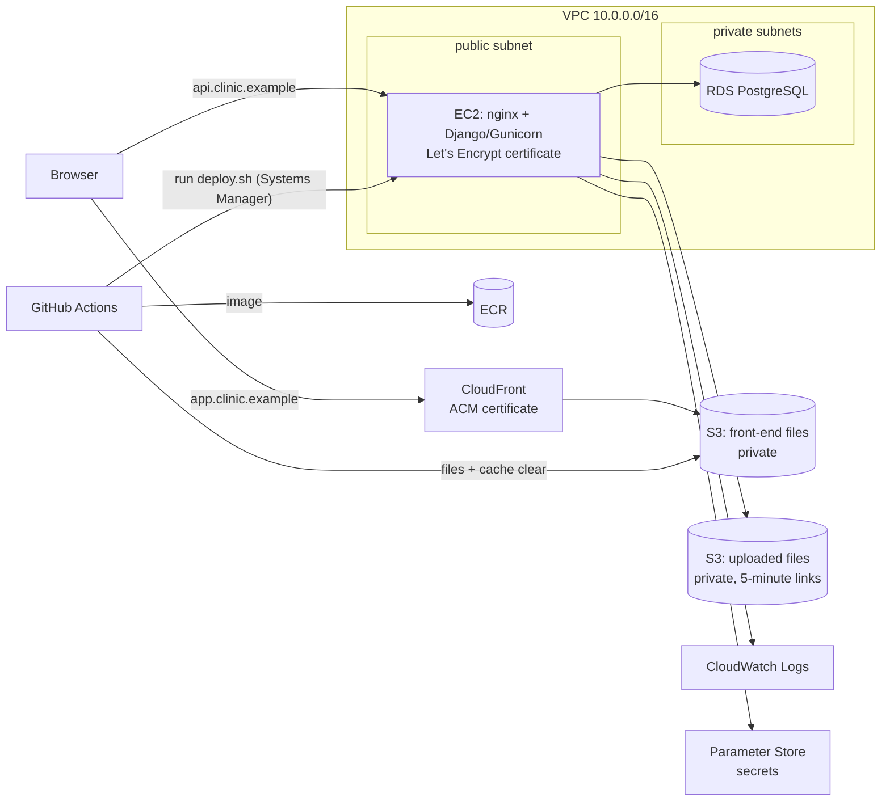

# Deploying CliniSar to AWS

A step-by-step guide to set up production by hand in the AWS console, region
**ap-south-1 (Mumbai)**, the closest region to Nepal. Each step says what it is for.
Nothing here is created automatically: after this setup, the CI workflow only ships new
releases.

Throughout, `clinic.example` stands for your domain. Replace it everywhere, and keep
the app and the API on the **same domain** (`app.clinic.example`,
`api.clinic.example`): the browser only sends the login cookie (`SameSite=Strict`)
between addresses of the same site.

## 0. What you will build



| Piece | Why |
| ----- | --- |
| VPC with public and private subnets | The database lives where the internet cannot reach it |
| EC2 (one server) | Runs nginx and the Django back end in Docker |
| RDS PostgreSQL | Managed database: backups, patches, encryption |
| S3 (media) | Uploaded documents and lab files, never public |
| S3 + CloudFront + ACM | Serves the React app fast over HTTPS |
| Route 53 | The `app.` and `api.` addresses |
| Parameter Store | Secrets (database password, Django key), kept out of Git |
| Certbot | Free HTTPS certificate for the API |
| CloudWatch Logs | Every request's log line, searchable by request id |
| ECR | Stores the back-end Docker images that CI builds |

Write down as you go: **account id**, the two **bucket names**, the **RDS endpoint**,
the **instance id**, the **CloudFront distribution id**.

## 1. VPC

**For**: a private network. Public subnets can reach the internet; private subnets
cannot, and only resources inside the VPC can reach them.

1. VPC console -> **Create VPC** -> **VPC and more**.
2. Name `clinisar`, IPv4 CIDR `10.0.0.0/16`.
3. **2** Availability Zones, **2** public subnets, **2** private subnets (RDS needs
   subnets in two zones, even for a single database).
4. NAT gateways: **None** (nothing in the private subnets needs the internet; this
   also avoids the NAT gateway's hourly cost). VPC endpoints: None.
5. Create.

## 2. Security groups

**For**: firewalls. Only the web ports reach the server, and only the server reaches
the database.

| Name | Inbound rules |
| ---- | ------------- |
| `clinisar-api` | TCP 80 and 443 from `0.0.0.0/0` and `::/0`. **No port 22**: you connect with Session Manager. |
| `clinisar-db` | TCP 5432 from the security group `clinisar-api` only |

Outbound: leave the default (all).

## 3. RDS PostgreSQL

**For**: the database, with daily backups, in the private subnets.

1. RDS -> **Subnet groups** -> Create: name `clinisar`, VPC `clinisar`, choose the two
   **private** subnets.
2. RDS -> **Create database** -> Standard create -> **PostgreSQL**, the newest version
   offered (development uses 18).
3. Template: Production or Free tier as your budget allows. A `db.t4g.micro` instance is
   enough to start.
4. DB instance identifier `clinisar`; master username `clinisar`; password: generate one
   with `openssl rand -hex 24` (letters and digits only; see step 7).
5. Connectivity: VPC `clinisar`, subnet group `clinisar`, **Public access: No**,
   security group `clinisar-db` (remove `default`).
6. Additional configuration: initial database name `clinisar`; automated backups 7
   days; encryption on; **deletion protection on**.
7. Create, then copy the **endpoint** (like `clinisar.xxxx.ap-south-1.rds.amazonaws.com`).

RDS requires encrypted connections by default; the database driver uses them
automatically.

## 4. S3 bucket for uploaded files

**For**: documents and lab result files. The bucket stays private; the API hands out
links that stop working after 5 minutes (`backend/config/settings/prod.py`).

1. S3 -> Create bucket: name e.g. `clinisar-media-<something unique>`, region
   ap-south-1.
2. **Block all public access: on.** Default encryption: SSE-S3.
3. Optional: turn on Versioning so a deleted file can be recovered.

## 5. ECR repository

**For**: the back-end images built by CI.

1. ECR -> Create repository: private, name **`clinisar-backend`** (the workflow uses
   this name), scan on push on.
2. Lifecycle policy: keep the last 20 images, so old releases remain for rollback
   without filling the registry.

## 6. IAM role for the server

**For**: the server gets AWS permissions without any key stored on it.

IAM -> Roles -> Create role -> AWS service **EC2**. Attach:

- `AmazonSSMManagedInstanceCore`: lets you open a shell in the browser (Session
  Manager) and lets CI run `deploy.sh` (Run Command). This is why no SSH port is open.
- `AmazonEC2ContainerRegistryReadOnly`: pull images from ECR.

Then add an inline policy (replace `MEDIA_BUCKET` and `ACCOUNT_ID`):

```json
{
  "Version": "2012-10-17",
  "Statement": [
    {
      "Sid": "UploadedFiles",
      "Effect": "Allow",
      "Action": ["s3:GetObject", "s3:PutObject", "s3:DeleteObject"],
      "Resource": "arn:aws:s3:::MEDIA_BUCKET/*"
    },
    {
      "Sid": "UploadedFilesList",
      "Effect": "Allow",
      "Action": "s3:ListBucket",
      "Resource": "arn:aws:s3:::MEDIA_BUCKET"
    },
    {
      "Sid": "ReadSettings",
      "Effect": "Allow",
      "Action": "ssm:GetParametersByPath",
      "Resource": "arn:aws:ssm:ap-south-1:ACCOUNT_ID:parameter/clinisar/production*"
    },
    {
      "Sid": "WriteLogs",
      "Effect": "Allow",
      "Action": [
        "logs:CreateLogGroup",
        "logs:CreateLogStream",
        "logs:PutLogEvents",
        "logs:DescribeLogStreams"
      ],
      "Resource": "arn:aws:logs:ap-south-1:ACCOUNT_ID:log-group:/clinisar/*"
    }
  ]
}
```

Name the role `clinisar-ec2`.

## 7. Parameter Store: settings and secrets

**For**: the back end's settings, encrypted, outside Git and outside the image.
`deploy/deploy.sh` reads everything under `/clinisar/production/` into
`/opt/clinisar/.env` (readable by root only) on every release.

Systems Manager -> Parameter Store -> Create parameter, one per row. Use **SecureString**
for secrets. Values must not contain `$`, quotes or spaces (generate secrets with
`openssl rand -hex ...`).

| Name | Type | Value |
| ---- | ---- | ----- |
| `/clinisar/production/DJANGO_SECRET_KEY` | SecureString | `openssl rand -hex 50` |
| `/clinisar/production/DJANGO_ALLOWED_HOSTS` | String | `api.clinic.example` |
| `/clinisar/production/CORS_ALLOWED_ORIGINS` | String | `https://app.clinic.example` |
| `/clinisar/production/API_DOMAIN` | String | `api.clinic.example` (nginx uses it) |
| `/clinisar/production/POSTGRES_HOST` | String | the RDS endpoint |
| `/clinisar/production/POSTGRES_PORT` | String | `5432` |
| `/clinisar/production/POSTGRES_DB` | String | `clinisar` |
| `/clinisar/production/POSTGRES_USER` | String | `clinisar` |
| `/clinisar/production/POSTGRES_PASSWORD` | SecureString | the RDS password |
| `/clinisar/production/AWS_STORAGE_BUCKET_NAME` | String | the media bucket |
| `/clinisar/production/AWS_S3_REGION_NAME` | String | `ap-south-1` |
| `/clinisar/production/GUNICORN_WORKERS` | String | `3` (optional; about 2 x CPU cores + 1) |

`DJANGO_SETTINGS_MODULE` is already set to production inside the image.

## 8. EC2 server

**For**: runs nginx and the back end.

1. EC2 -> Launch instance: name `clinisar-api`, **Ubuntu Server 24.04 LTS**,
   `t3.small` (2 GB memory; three Gunicorn workers fit comfortably).
2. Key pair: **none** (Session Manager is used instead).
3. Network: VPC `clinisar`, a **public** subnet, auto-assign public IP on, security
   group `clinisar-api`.
4. Storage: 20 GB gp3, encrypted.
5. Advanced details -> IAM instance profile: `clinisar-ec2`.
6. Launch. Then EC2 -> **Elastic IPs** -> Allocate -> Associate with the instance, so
   the address never changes (DNS points at it).
7. Copy the **instance id** (`i-...`).

Open a shell: select the instance -> **Connect** -> **Session Manager**. Install
Docker, Certbot and the AWS CLI, and put the deployment files in `/opt/clinisar`:

```bash
sudo apt-get update
sudo apt-get install -y docker.io docker-compose-v2 certbot git
sudo snap install aws-cli --classic

sudo git clone https://github.com/<your-account>/CliniSar.git /opt/clinisar-src
sudo mkdir -p /opt/clinisar
sudo cp -r /opt/clinisar-src/deploy/. /opt/clinisar/
ls /opt/clinisar   # deploy.sh  docker-compose.prod.yml  nginx/
```

`/opt/clinisar` then holds:

| File | What it does |
| ---- | ------------ |
| `deploy.sh` | One release: secrets -> pull image -> migrate -> restart |
| `docker-compose.prod.yml` | The two containers (nginx, backend) and their CloudWatch logging |
| `nginx/templates/default.conf.template` | HTTPS, HTTP->HTTPS redirect, per-IP limits |

These files rarely change. When they do: `cd /opt/clinisar-src && sudo git pull &&
sudo cp -r deploy/. /opt/clinisar/`. (If the repository is private, copy the three
files in by hand instead of cloning.)

## 9. DNS and the API certificate (Route 53 + Certbot)

**For**: the `api.` address, and HTTPS for it.

1. Route 53 -> Hosted zones -> your domain (create it if needed, and point the domain
   registrar at its name servers).
2. Create record: `api` type **A**, value: the Elastic IP.
3. On the server (Session Manager), once `api.clinic.example` resolves to the Elastic IP:

```bash
sudo certbot certonly --standalone -d api.clinic.example \
  -m you@clinic.example --agree-tos -n \
  --pre-hook "docker stop clinisar-nginx-1 || true" \
  --post-hook "docker start clinisar-nginx-1 || true"
sudo certbot renew --dry-run
```

Certbot briefly answers on port 80 to prove you own the name. The certificate lands in
`/etc/letsencrypt/live/api.clinic.example/`, which the nginx container reads.
Ubuntu's certbot package renews it automatically (a systemd timer, twice a day; renewal
happens 30 days before the 90-day expiry). The hooks stop nginx for those few seconds,
so port 80 is free, and start it again with the new certificate.

## 10. Front end: S3 + CloudFront + ACM

**For**: the React app, delivered over HTTPS from servers close to the user.

1. **Bucket**: S3 -> Create bucket `clinisar-app-<something unique>`, ap-south-1,
   **Block all public access: on** (CloudFront reads it through Origin Access Control).
2. **Certificate**: ACM in region **us-east-1** (CloudFront only uses certificates from
   there) -> Request a public certificate for `app.clinic.example` -> DNS validation ->
   "Create records in Route 53". Wait until it is Issued.
3. **Response headers policy**: CloudFront -> Policies -> Response headers -> Create:
   - Strict-Transport-Security: max-age 31536000, include subdomains.
   - X-Content-Type-Options: nosniff. X-Frame-Options: DENY.
   - Referrer-Policy: strict-origin-when-cross-origin.
   - Content-Security-Policy (one line; replace the API address):

     ```
     default-src 'self'; script-src 'self'; style-src 'self' 'unsafe-inline'; img-src 'self' data: blob:; font-src 'self' data:; connect-src 'self' https://api.clinic.example; frame-ancestors 'none'; base-uri 'self'; form-action 'self'; object-src 'none'
     ```

     Scripts only from the app itself, API calls only to the API. `'unsafe-inline'`
     for styles is needed because the component library (Mantine) sets style
     attributes. This exact policy was tested with a production build (phase 11).
4. **Distribution**: CloudFront -> Create distribution:
   - Origin: the app bucket; Origin access: **Origin access control** (create one);
     after creating, copy the bucket policy CloudFront shows into the bucket.
   - Viewer protocol policy: **Redirect HTTP to HTTPS**. Cache policy: CachingOptimized.
   - Response headers policy: the one from step 3.
   - Alternate domain name `app.clinic.example`, certificate from step 2.
   - Default root object `index.html`. Price class: include Asia (India edge locations).
5. **Single-page app routes**: distribution -> Error pages -> create two custom error
   responses: **403** and **404** -> response page `/index.html`, HTTP code **200**,
   error caching TTL **0**. (A link like `/patients/123` has no file in S3; the app's
   router handles it.)
6. Route 53: record `app` -> **Alias** -> the CloudFront distribution.
7. Copy the **distribution id**.

## 11. GitHub: deploy user, secrets and variables

**For**: CI ships releases with the least access it needs.

IAM -> Users -> Create `clinisar-github-deploy` (no console access). Inline policy
(replace the capitals):

```json
{
  "Version": "2012-10-17",
  "Statement": [
    { "Sid": "EcrLogin", "Effect": "Allow", "Action": "ecr:GetAuthorizationToken", "Resource": "*" },
    {
      "Sid": "EcrPush",
      "Effect": "Allow",
      "Action": [
        "ecr:BatchCheckLayerAvailability", "ecr:InitiateLayerUpload", "ecr:UploadLayerPart",
        "ecr:CompleteLayerUpload", "ecr:PutImage", "ecr:BatchGetImage"
      ],
      "Resource": "arn:aws:ecr:ap-south-1:ACCOUNT_ID:repository/clinisar-backend"
    },
    {
      "Sid": "RunDeployScript",
      "Effect": "Allow",
      "Action": "ssm:SendCommand",
      "Resource": [
        "arn:aws:ec2:ap-south-1:ACCOUNT_ID:instance/INSTANCE_ID",
        "arn:aws:ssm:ap-south-1::document/AWS-RunShellScript"
      ]
    },
    { "Sid": "ReadDeployResult", "Effect": "Allow", "Action": "ssm:GetCommandInvocation", "Resource": "*" },
    {
      "Sid": "FrontendFiles",
      "Effect": "Allow",
      "Action": ["s3:PutObject", "s3:ListBucket"],
      "Resource": ["arn:aws:s3:::APP_BUCKET", "arn:aws:s3:::APP_BUCKET/*"]
    },
    {
      "Sid": "ClearCdnCache",
      "Effect": "Allow",
      "Action": "cloudfront:CreateInvalidation",
      "Resource": "arn:aws:cloudfront::ACCOUNT_ID:distribution/DISTRIBUTION_ID"
    }
  ]
}
```

Create an access key for this user. `ssm:SendCommand` can run commands as root on the
server, so the key lives only in GitHub secrets; delete and replace it if it leaks.

GitHub -> repository -> Settings -> Secrets and variables -> Actions:

| Kind | Name | Value |
| ---- | ---- | ----- |
| Secret | `AWS_ACCESS_KEY_ID` | the access key id |
| Secret | `AWS_SECRET_ACCESS_KEY` | the secret access key |
| Variable | `EC2_INSTANCE_ID` | `i-...` |
| Variable | `API_URL` | `https://api.clinic.example` (no trailing slash) |
| Variable | `FRONTEND_BUCKET` | the app bucket name |
| Variable | `CLOUDFRONT_DISTRIBUTION_ID` | the distribution id |

## 12. First release and the first clinic

1. Push to `main`. GitHub -> Actions shows four jobs: back-end checks, front-end checks,
   then **Deploy back end** and **Deploy front end**.
2. Check: `https://api.clinic.example/api/docs/` shows the API docs and
   `https://app.clinic.example` shows the login page.
3. Create the super admin (Session Manager on the server):

   ```bash
   cd /opt/clinisar
   sudo docker compose -f docker-compose.prod.yml exec backend python manage.py createsuperuser
   ```

4. Sign in at `https://api.clinic.example/admin/`, create the **Clinic** and its first
   **Clinic admin** user. That admin signs in to the app and sets up departments,
   doctors, staff, medicines and lab tests.

Never run `seed_demo` on production: it creates made-up clinics and patients.

## 13. Logs in CloudWatch

Every request writes one line, for example:

```
2026-11-22 10:15:02,118 INFO clinisar.requests POST /api/v1/appointments/ 201 84ms id=3f2a9c1e7b0d4c55a1e2f3a4b5c6d7e8
```

- Where: CloudWatch -> Log groups -> **`/clinisar/production`**, streams `backend` and
  `nginx`. Set the group's **retention** (e.g. 3 months) so old logs are deleted.
- **Find one user's error**: when the server fails, the app's message ends with
  "(reference 3f2a9c1e)", the first 8 characters of the request id. (Every response
  also carries the full id in its `X-Request-ID` header, visible in the browser's
  developer tools.) CloudWatch -> Logs Insights -> group
  `/clinisar/production`:

  ```
  fields @timestamp, @logStream, @message
  | filter @message like /id=3f2a9c1e/
  | sort @timestamp desc
  ```

  Python errors (tracebacks) are written by the same process right next to that line;
  widen the time range around it.
- **All server errors today**: `filter @message like / 5\d\d \d+ms/`.
- **Rate-limited requests**: `filter @message like / 429 /`.

## 14. Day-to-day

| Task | How |
| ---- | --- |
| Release | Push to `main` (after the checks pass, both deploy jobs run). |
| Roll back the back end | Find an older tag in ECR, then on the server: `sudo /opt/clinisar/deploy.sh <registry>/clinisar-backend:<tag>`. Database migrations are not undone. |
| Roll back the front end | Re-run the "Deploy front end" job of an older commit in GitHub Actions. |
| Look inside | Session Manager, then `cd /opt/clinisar && sudo docker compose -f docker-compose.prod.yml ps` (or `logs backend`). |
| Change a setting | Edit it in Parameter Store, then re-run the last back-end deploy (or `sudo /opt/clinisar/deploy.sh <current image>`). |
| Database backups | Automatic (RDS, 7 days). Before a risky migration: RDS -> Actions -> Take snapshot. |

## 15. Security summary

| Layer | Protection |
| ----- | ---------- |
| Network | Only ports 80/443 open on the server; database reachable only from the server; no SSH |
| Transport | HTTPS everywhere; HTTP redirected; HSTS for a year (API by Django, app by CloudFront) |
| Headers | API: nosniff, X-Frame-Options DENY, Referrer-Policy. App: the same plus a strict Content-Security-Policy |
| Rate limits | nginx per IP (20/s, bursts of 100; admin login 5/min); Django per user 300/min, not logged in 120/min per IP, login 5/min, shared by all workers through the database cache |
| Secrets | Parameter Store (encrypted); server permissions through its IAM role; CI key limited to deploying |
| Files | Private buckets; uploaded files reachable only through 5-minute links |
| Data | RDS encrypted, automatic backups, deletion protection |
