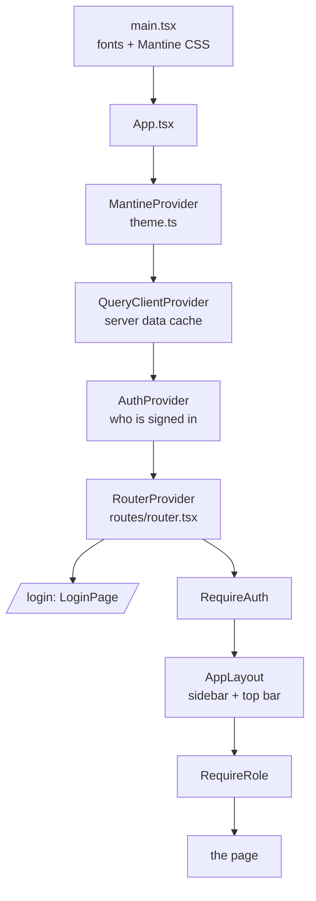
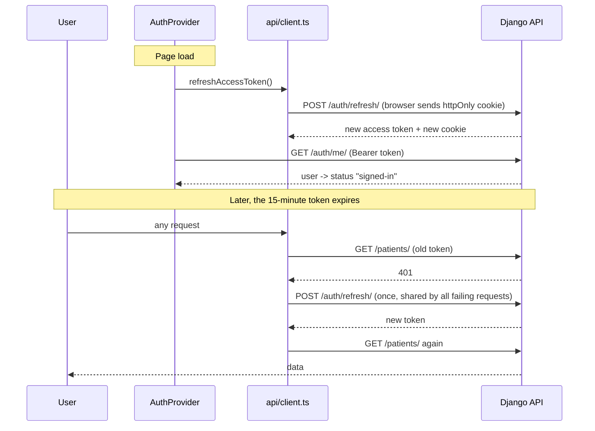
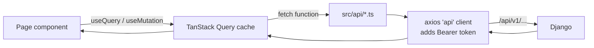

# CliniSar front end: how it works

The front end is a single-page React app written in TypeScript. This document explains
how it is put together, how data flows from a click to the database and back, which
code does what, why each choice was made, and how the screens follow Shneiderman's
eight golden rules of interface design.

## 1. Stack, and why each part

| Part | Library | Why |
| ---- | ------- | --- |
| UI framework | React 19 + TypeScript | components, and type errors caught before running |
| Build tool | Vite 8 | fast dev server; production build split into cached files |
| Components | **Mantine 9** | industry-standard, accessible components (focus handling, keyboard support, screen-reader labels) instead of hand-written ones; one theme file controls the whole look |
| Icons | lucide-react | clean outline icons, as in the reference design |
| Routing | React Router 8 | addresses for every screen, nested layouts, route guards |
| Server data | TanStack Query | caching, loading/error states, refetching, no duplicate requests |
| HTTP | Axios | interceptors for the access token and the one-time refresh |
| Forms | React Hook Form + Zod | fast forms; rules written once as a schema, with clear messages |
| Charts | Mantine Charts (built on Recharts) | dashboard donut and bar charts in the theme colours |
| BS calendar | @remotemerge/nepali-date-converter | the only maintained library covering BS 2000-2099 (see section 6) |
| Tests | Vitest + Testing Library + jsdom | tests that use the screen like a person: find by label, click, read |

Mantine replaced Tailwind on purpose (decision recorded in `docs/PHASES.md`): one
styling system, a documented component library examiners recognise, and less custom
UI code to maintain.

## 2. How the app starts



The order matters: the theme wraps everything; React Query sits above the auth provider
because signing out clears the cached data; the router sits inside both so every page
can read the user and server data.

## 3. Signing in and staying signed in



Key rules (`src/api/client.ts`, `src/features/auth/AuthProvider.tsx`):

- The **access token lives only in memory** (a variable in `client.ts`), never in
  `localStorage`; a script injected into the page cannot read it from storage.
- The **refresh token is an httpOnly cookie**: JavaScript cannot read it at all.
  (Checked in a real browser: `localStorage` is empty and `document.cookie` does not
  contain it.)
- On a 401 the client refreshes **once** and repeats the request. If several requests
  fail at the same moment, they **share one refresh**: the server rotates refresh
  tokens, so two parallel refreshes would log the user out.
- If the refresh fails, the session has ended: the app clears all cached data (so the
  next user never sees it) and shows the login page with "Your session has ended".
- In development, Vite forwards `/api` to Django, so the browser sees one site and the
  `SameSite=Strict` cookie works. In production, Nginx does the same job.

## 4. How data flows for a normal screen



Four kinds of state, each in its own place:

| State | Lives in | Example |
| ----- | -------- | ------- |
| Server data | TanStack Query cache | patient lists, invoices, the dashboard |
| Who is signed in | `AuthContext` | user, role, clinic |
| Form input | React Hook Form + Zod | the login form |
| Where you are | the URL | `/patients?search=ram`, `/invoices/<id>` |

Why: each has different needs (server data must be refetched and shared, form data must
be validated, the URL must survive a reload and be shareable). Mixing them is the usual
source of front-end bugs.

Errors are turned into plain sentences in one place (`src/api/errors.ts`): a 429 says
"wait a minute", a lost connection says "Cannot reach the CliniSar server", and an
unexpected server error shows a short reference (the request id) that matches the
server log.

## 5. Roles on screen

`src/routes/navigation.ts` lists every screen and the roles that may open it. **Both**
the sidebar (`Sidebar.tsx`) and the route guard (`RequireRole.tsx`) read this one list,
so a menu item and its page can never disagree. Typing a forbidden address shows
"This page is not for your role" instead of a broken page. The API still checks every
request; the screen rules only keep the interface honest.

## 6. Nepal: Bikram Sambat dates and rupees

`src/lib/date.ts` is the **only** file that imports the BS library.

- The API always speaks AD (`"2026-11-18"`) and UTC timestamps. The screen shows BS:
  `formatBS("2026-11-18")` -> `"2083 Mangsir 2"`, with the AD date in small muted text
  (`DateText` component). Print pages use the numeric style `2083/08/02`, as on the
  clinic's paper forms.
- `toAD()` turns a BS date picked on screen back into AD for the API.
- `formatNepalTime()` shows a UTC timestamp in Kathmandu time (UTC+5:45).
- Weeks start on Sunday.

**Library choice** (the brief asked for evidence): four maintained libraries were tested
on every month of BS 2000-2099 in four time zones.

| Library | Covers up to | Monthly downloads |
| ------- | ------------ | ----------------- |
| nepali-date-converter | BS 2090 (fails the requirement) | 61,501 |
| bikram-sambat | BS 2090 (fails) | 11,869 |
| **@remotemerge/nepali-date-converter** | **BS 2099** | 6,403 |
| nepali-date-library | BS 2100 | 2,015 |

The chosen library converts all 36,525 days of BS 2000-2099 to AD and back with no
gap, gives identical results in every time zone (it works on plain text, not on
JavaScript `Date`), is 5 KB with no dependencies, and was released in October 2026.
All libraries agree up to BS 2084; after that the official calendar is not yet
published and every library projects. Because the database stores **AD**, a future
correction would only change how a date is displayed, never the stored data.

**The BS date picker** (`src/components/BsDatePicker.tsx`) is our own, built on
`date.ts`. Mantine's picker is AD-only, and the BS picker packages on npm either
support only React 18 or bundle a different calendar table (which could disagree with
the rest of the app by a day). It supports the keyboard (arrows, Page Up/Down, Enter,
Esc), min/max dates, "Today" and "Clear".

`src/lib/money.ts`: `formatRs("125000")` -> `"Rs. 1,25,000.00"` (lakh grouping), and
`amountInWords("94.92")` -> `"Rupees Ninety-Four and Ninety-Two Paisa Only"` for the
"In Words" line of printed bills. Money arrives as exact decimal text; the front end
never calculates totals, it only formats them.

## 7. Design system

**One theme file**: `src/theme.ts` holds every colour, the font, spacing, radius and
the default settings of each Mantine component. Pages never hard-code a colour.

- **Colours**: the brief's 13 colours are the anchors. Mantine needs ten steps per
  colour (for hover and light backgrounds); each scale is built around its anchor at
  step 6. `cssVariablesResolver` points Mantine's own text, muted-text and border
  colours at the brand tokens, so built-in components match too. Chart colours, in
  order: primary, primary-light, slate, grey (`CHART_COLORS`).
- **Font**: Inter (bundled with the app, not loaded from Google, so it works offline
  and leaks no visitor data).
- **Spacing: an 8-point grid.** Every gap and padding is 4, 8, 16, 24 or 32 px
  (`xs`, `sm`, `md`, `lg`, `xl`). Pages have 24 px padding on desktop (16 px on
  phones), cards have 24 px inside and 24 px between them, form fields 16 px apart,
  table cells 8 px x 16 px. A single scale makes every screen line up.
- **Shape**: controls have an 8 px radius, cards 12 px with a 1 px border and no heavy
  shadow (as in the reference dashboard).
- **Layout**: fixed 260 px blue sidebar, 64 px white top bar, light grey page; below
  1024 px the sidebar becomes a drawer (theme breakpoint `lg` = 1024 px).
- **Status colours**: one mapping for every badge (`StatusBadge.tsx`): green = done or
  paid, pink = cancelled, expired or abnormal, blue = in progress, slate = waiting.

## 8. Shneiderman's eight golden rules, in this app

| # | Rule | How CliniSar applies it | Code |
| - | ---- | ----------------------- | ---- |
| 1 | **Strive for consistency** | one theme, one table component for every list, one badge per status, one header block per page, the same feedback style everywhere | `theme.ts`, `DataTable.tsx`, `StatusBadge.tsx`, `PageHeader.tsx`, `lib/notify.ts` |
| 2 | **Universal usability** (novices and experts) | press `/` to jump to patient search; full keyboard use of the date picker; every control labelled for screen readers; works on phones (drawer, larger touch targets) | `TopBar.tsx`, `BsDatePicker.tsx`, `AppLayout.tsx` |
| 3 | **Informative feedback** | buttons show a spinner while saving; tables show skeleton rows while loading; every action ends with a success or error message in plain words (one helper for all screens); the bell shows what needs attention | `DataTable.tsx`, `lib/notify.ts`, `api/errors.ts`, `AlertsMenu.tsx` |
| 4 | **Dialogs that yield closure** | each task ends clearly: sign-in lands on the dashboard (or the page you came from), sign-out confirms "You have signed out", a failed load offers "Try again" | `LoginPage.tsx`, `AuthProvider.tsx`, `ErrorState.tsx` |
| 5 | **Prevent errors** | form rules checked before sending (Zod); dates are picked, never typed; impossible dates (before a minimum, outside BS 2000-2099) cannot be chosen; menus show only what the role may do | `LoginPage.tsx`, `BsDatePicker.tsx`, `navigation.ts` |
| 6 | **Easy reversal of actions** | anything that cannot be undone (cancel, delete) asks first, with the safe button focused; Cancel always leaves a form without saving | `ConfirmDialog.tsx` |
| 7 | **Keep users in control** | nothing happens without a click; no automatic page jumps except after an action the user asked for; the drawer closes with X or Esc; data refreshes quietly in place | `AppLayout.tsx`, `Sidebar.tsx`, `App.tsx` (query settings) |
| 8 | **Reduce short-term memory load** | page titles and descriptions say where you are; detail pages have a "back to list" link; BS dates always come with the AD date; the account menu shows clinic and role; the login page says where to get a password | `PageHeader.tsx`, `DateText.tsx`, `UserMenu.tsx` |

## 9. Production qualities

- **Build**: `tsc -b && vite build`. The first load is our shared code (~29 KB) plus
  `react`, `mantine` and `vendor` files that browsers keep cached between releases
  (`vite.config.ts`). **Every page loads only when first opened** (`React.lazy` in
  `routes/router.tsx`), 1-10 KB each. The chart libraries are deliberately left out of
  the shared files, so they travel with the dashboard alone and never slow down
  sign-in or the other screens.
- **Accessibility**: Mantine components handle focus and ARIA; we add labels to icon
  buttons, `role="alert"` to errors, `aria-current` to the active menu item and to
  today in the calendar, and keep visible focus outlines.
- **Resilience**: requests retry only for network or 5xx errors (never for "not allowed"
  or "invalid"); a 20-second timeout; data stays fresh for 30 seconds then refreshes.
- **Security**: no token in storage, cookie not readable by scripts, all cached data
  cleared on sign-out or session end.
- **Tests** (`npm test`): conversions and money, the token refresh rules (including the
  single shared refresh), error messages, menus and access per role, route guards, the
  login page, the table states, the date picker, and the layout. A real-browser check
  (headless Chrome) covers sign-in, reload, roles, mobile drawer and sign-out.

## 10. The screens (phase 10)

Every screen follows the same pattern: a `PageHeader`, then a white card with filters
on top (kept in the address bar by `useListState`, so a reload keeps your place) and a
`DataTable`; "add/edit" happens in a `FormModal`; anything that cannot be undone goes
through `ConfirmDialog` (or `CancelWithReason` when a reason is required); every
action ends with a plain-words notification from `lib/notify.ts`.

| Area | Screens | Notes |
| ---- | ------- | ----- |
| Administration | Departments, Staff, Doctors (with working hours), Settings, My profile | Settings say clearly that VAT changes apply to new bills only |
| Patients | List with search, register (age **or** date of birth, phone optional), patient record with tabs | Tabs show only what the role may open |
| Appointments | Day view (BS picker, previous/next day), new appointment | Walk-in or booked slot; the summary shows the bill that will be created; a slot taken meanwhile (409) refreshes the free slots |
| Prescriptions | List (pharmacist starts on "Waiting"), detail, write (doctor) | Dispense explains exactly what happens; a 409 names the missing medicine |
| Pharmacy | Medicines (Low stock badge), medicine detail (batches, purchase, adjust, history), Expiry | Expiry dates show "Expires soon" / "Expired"; one-click write-off |
| Lab | Lab tests (report rows editor), lab orders, lab order detail | Results form with section headings, Normal/Abnormal per row, optional file |
| Bills | List, detail with the same totals as the paper bill | Take payment (discount recalculated by the server), cancel with reason, print |
| Documents | List, upload (type and 10 MB checked before sending), delete | |
| Dashboard ("Today") | Task-first per role (see below), then the clinic's figures for admin and front desk | `features/dashboard/` |

**Task-first screens.** Working pages are shaped by the work, not by a generic
"header + table" template:

| Who | Opens on | Shape |
| --- | -------- | ----- |
| Front desk, admin | Today: figures strip, **queue per doctor**, "Needs action" (unpaid bills, lab patients to check, lab work, prescriptions waiting, stock), then clinic figures and charts | `FrontDeskToday.tsx` |
| Doctor | **Next patient** with Write prescription / Order tests / Seen, the rest of the queue, latest lab results | `DoctorToday.tsx` |
| Pharmacist (front desk too) | Who is waiting, low stock, expiring batches; Prescriptions opens the **dispensing counter** (list left, stock check right, Dispense disabled while anything is short) | `PharmacyToday.tsx`, `DispensingCounter.tsx` |
| Lab technician | The **lab board**: to collect, results to enter, done today | `LabToday.tsx`, `LabBoard.tsx` |
| Appointments | **Queue board** per doctor in calling order (due bookings, walk-ins by number, later bookings), or a list | `QueueBoard.tsx`, `lib/queue.ts` |

The rules behind these boards are small pure functions with unit tests:
`lib/queue.ts` (calling order, columns per doctor), `lib/stock.ts` (shortages before
dispensing), `lib/labWork.ts` (lab columns). Visit actions (seen, cancel, prescribe,
order tests) live in one hook, `useVisitActions`, so every board and list behaves alike.

**One person, one record.** Before registering, `PatientForm` looks up patients with
the same name (`?first_name__iexact=&last_name__iexact=`) and asks "Is this one of
them?" with a **This is the patient** button. If the server still refuses (same name
and phone, 409), the form shows the existing patient and offers **Use ...** instead.
`getDuplicatePatient` (`api/errors.ts`) reads that answer.

**Lab registrations.** In the lab order dialog, **New patient** opens the normal patient
form; the API flags that patient (`needs_review`), and the front desk sees it in the bell,
in "Needs action" and as a "Check details" badge until someone presses **Details checked**.

## 11. Printing (phase 10)

Routes under `/print/...` show one document with no sidebar, top bar or buttons and
open the print dialog once the data has loaded (`print/PrintLayout.tsx`).

| Route | Paper | Looks like |
| ----- | ----- | ---------- |
| `/print/invoice/:id` | A4, 15mm margins | the clinic's bill book: PAN in boxes, S.N./Particular/Qty/Rate/Rs./Ps., totals, In Words, Issued by |
| `/print/receipt/:id` | 80mm or 58mm roll (clinic setting) | one monospace column; only for PAID bills |
| `/print/prescription/:id` | A4 | doctor's letterhead (Nepali and English, NMC No.), Rx table, clinic name/address/validity note in Nepali at the bottom |
| `/print/lab-order/:id` | A4 | patient box (consultant, Lab No., collection and reporting dates), one heading per category, sections, abnormal values marked *, `>>END OF REPORT<<`, signature lines |

- Totals (Subtotal, Discount if any, Taxable amount and "VAT x%" only when the bill's
  own rate is above 0, Total) come from **one function**, `totalLines()` in
  `lib/bills.ts`, used by the bill screen and both bill printouts.
- **Receipt paper size**: the brief's `size: 80mm auto` is not accepted by browsers
  (a PDF test showed Chrome falling back to Letter paper). The receipt is measured just
  before printing and given its exact height, e.g. `size: 80mm 90mm`, so it prints as
  one continuous strip.
- Printed dates are numeric BS (`2083/08/02`) with the AD date beside them; black text
  on white, no theme colours.
- Checked by printing all four to PDF in headless Chrome: three single A4 pages and an
  80mm receipt.

## 12. Folder map

```
src/
  main.tsx, App.tsx      start-up and providers
  theme.ts               the design system
  api/                   client.ts (token + refresh), errors.ts, one file per area
  features/auth/         AuthContext, AuthProvider, useAuth
  routes/                navigation.ts (screens + roles), router.tsx, guards
  components/            shared components (DataTable, StatCard, BsDatePicker, ...)
  components/layout/     AppLayout, Sidebar, TopBar, AlertsMenu, UserMenu
  features/<area>/       the screens of each area (patients, appointments, billing, ...)
  pages/                 login, not found, forbidden
  print/                 PrintLayout, PrintHeader and the four printouts
  lib/                   date.ts, money.ts, notify.ts, labels.ts
  test/                  setup and the render helper
```

## 13. Where to start reading

1. `src/api/client.ts` - the session rules in 80 lines.
2. `src/features/auth/AuthProvider.tsx` - restoring and ending a session.
3. `src/routes/navigation.ts` - screens and roles.
4. `src/theme.ts` - the whole look.
5. `src/lib/date.ts` - Bikram Sambat.
6. `src/components/DataTable.tsx` - how every list behaves.
7. `src/features/appointments/NewAppointmentPage.tsx` - a typical multi-step form.
8. `src/lib/bills.ts` and `src/print/InvoicePrint.tsx` - one set of totals for screen and paper.
